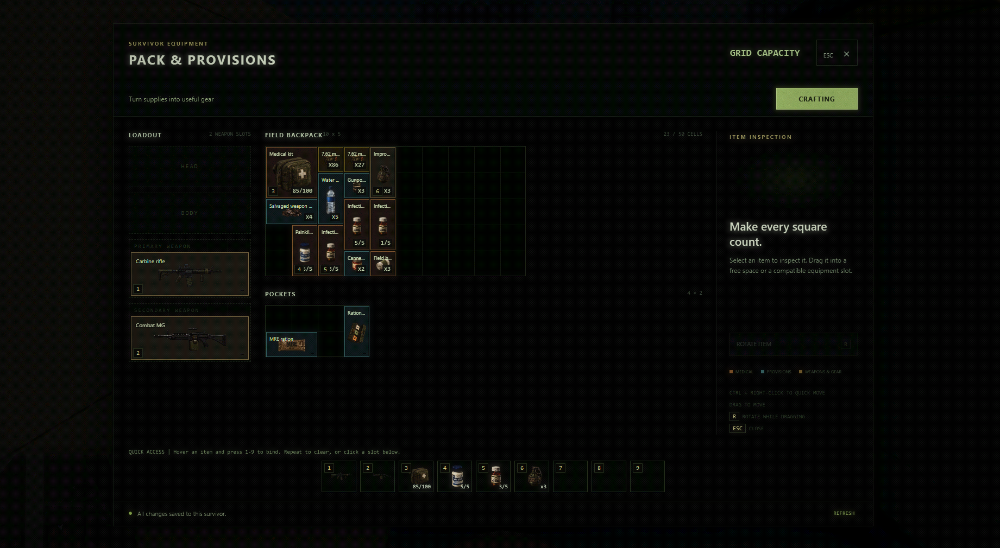
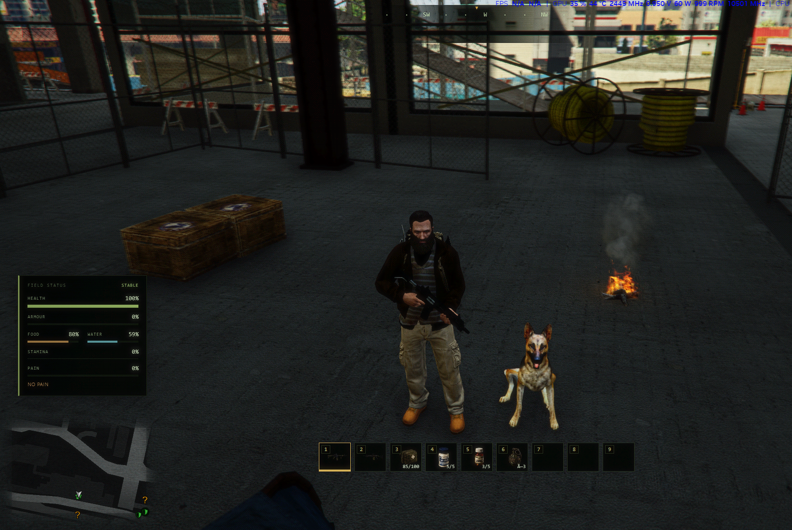
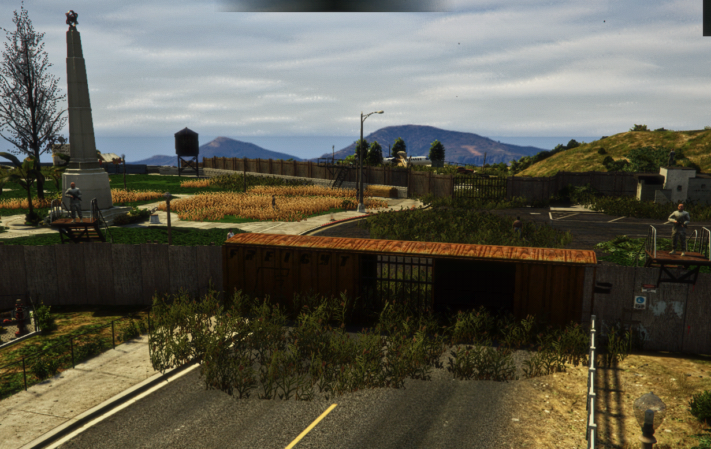

# CWFS Zombie Survival

A customizable FiveM zombie survival framework by **Cold Water Forge Studios**.

## Download

[Download the initial release and installation package](https://github.com/CWFS-Framework/CWFS-Zombie-Survival/releases/latest).

Choose **CWFS-Zombie-Survival-public-2026-10-13-hotfix1.zip** under Assets. This named ZIP contains the complete framework source and installable resources. The repository currently hosts this overview; GitHub’s automatic Source code archives are not the installation package.

## Get started

1. Set up a FiveM server using txAdmin’s Basic Server template.
2. Extract the installation ZIP and read **README.txt**.
3. Follow **docs/DEPENDENCIES.txt** to obtain the separate zombie and dog models.
4. Use the supplied database setup and configuration templates, then run the preflight check.
5. Follow **docs/FIRST-START-CHECKLIST.txt** on your server.

FXServer itself is not included. Your own server key and database settings are required.

## Included systems

- Persistent characters and grid inventory with backpack upgrades
- Survival needs, weather, camps and compounds
- Crafting, scavenging, zombies and Horde Night
- Dog companions, clans, admin tools and custom recycler
- Clean database setup, configuration examples and admin bridge instructions
- Loading-screen customization guide and third-party credits/download links
- Bob74’s IPL loader, with its MIT license, for base-map and DLC placements

## Tested baseline

Database migrations and package checks passed. The server owner confirmed item grants and use, character and inventory persistence after reconnecting, and the reported Hills terrain fix on a clean installation. This is an initial release; these basic smoke tests do not cover every gameplay system or hosting configuration.

## Credits and customization

Keep the supplied resource names when installing. Follow the customization guide to add items or change settings. Third-party resources retain their own licenses and credits; optional models, maps, clothing and sound packs are linked in the dependency guide rather than bundled.

## In-game gallery

Captured on the creator's customized server with ReShade enabled. The dog model, backpack/clothing and optional map additions are separate third-party downloads; they are not bundled in the framework ZIP. See the dependency guide for sources and credits.

### Grid inventory

### Camp and companion

### Fortified environment
Example scene from the customized server; optional map content is installed separately.

